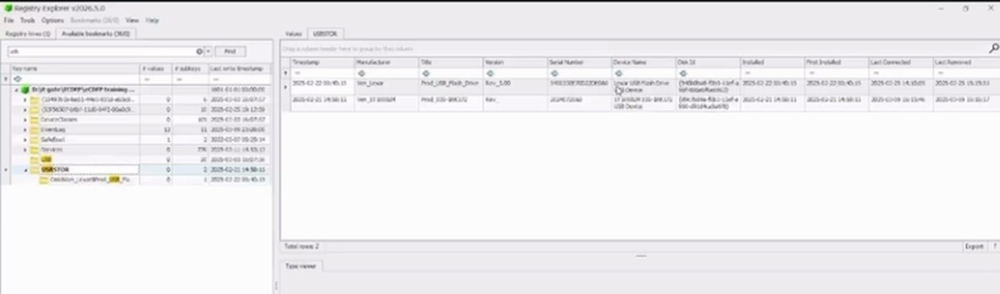
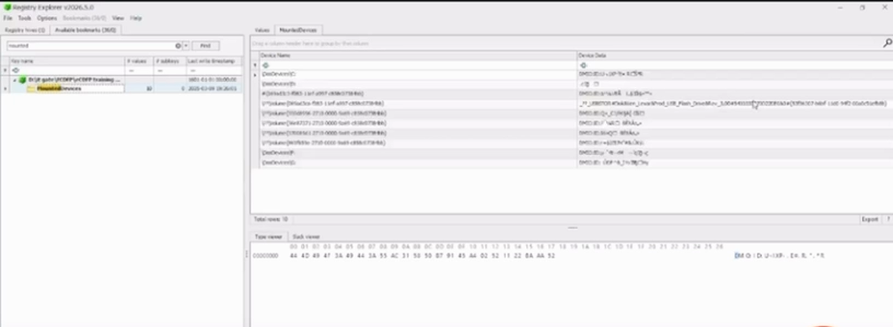
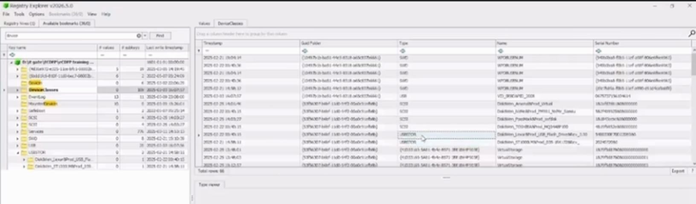

# USB Registry Investigation — Windows DFIR Lab

## Overview
This project documents a Windows Registry investigation based on a simulated scenario in which an employee may have connected a personal USB device to a workstation. It reviews registry artifacts that can help establish whether Windows recognized a USB storage device and how the reported activity relates to a supplied logon timeline.

> **Evidence boundary:** Registry evidence may support that a device was recognized. By itself, it does not prove that files were copied or that data exfiltration occurred.

## Objectives
- Review USB-related artifacts in the Windows `SYSTEM` hive.
- Examine `USBSTOR`, `MountedDevices`, and `DeviceClasses`.
- Correlate the reported USB connection time with the supplied employee logon time.
- Document findings, limitations, and follow-up steps.

## Tools
- Registry Explorer
- Windows `SYSTEM` registry hive

## Reported observations
| Item | Observation | Interpretation |
|---|---|---|
| Employee logon | `2025-02-25 14:10` | Reference time supplied in the lab notes |
| USB device | Lexar USB Flash Drive, Rev 3.00 | Device identification from USB-related registry evidence |
| USB connection | `2025-02-25 14:10:09` (last connected) | Approximately 9 seconds after logon |
| Windows recognition | USB-related registry locations reviewed | Consistent with Windows recognizing the device |

These observations come from the lab notes and a low-resolution walkthrough video. Verify them against the original evidence before treating them as independently confirmed.

## Screenshots
| USBSTOR | MountedDevices | DeviceClasses |
|---|---|---|
|  |  |  |

## Registry artifacts

### `SYSTEM\CurrentControlSet\Enum\USBSTOR`
Stores enumeration information for USB mass-storage devices. Device descriptions and instance identifiers can help identify an enumerated device. This does not prove file copying.

### `SYSTEM\MountedDevices`
Stores mappings between volume/device identifiers and mounted volume assignments. A mapping can provide context about a mounted volume, but does not establish which files were accessed or transferred.

### `SYSTEM\CurrentControlSet\Control\DeviceClasses`
Contains device-interface registration information. It may corroborate device presence, but interpretation depends on the specific key/value and Windows version.

## Conclusion
The registry review identified a Lexar USB mass-storage device, last connected approximately nine seconds after the employee logon reference time. This is consistent with Windows recognizing the device shortly after logon.

**The registry findings do not establish that files were copied, confidential data was transferred, or exfiltration occurred.**

## Limitations
- Original hive, acquisition details, and evidence hashes are not included in this project.
- Exact key/value details and timestamp semantics need verification against the original evidence.
- A connected USB device does not by itself prove file access or copying.
- The observations do not establish who connected the device or their intent.

## Recommended next steps
1. Preserve the original evidence and work from verified forensic copies.
2. Record SHA-256 hashes and acquisition details.
3. Examine `NTUSER.DAT`, LNK files, Jump Lists, and ShellBags for user activity.
4. Review `$MFT` and `$UsnJrnl`, where available, for file-system activity.
5. Correlate Windows event logs and endpoint telemetry if available.
6. Document exact artifact paths, values, timestamps, and screenshots.

## Project structure
- `report/investigation-report.md` — investigation report
- `evidence/investigation-timeline.md` — timeline and validation notes
- `screenshots/` — Registry Explorer screenshots

## LinkedIn demonstration
**LinkedIn video post:** [Watch the investigation walkthrough](https://lnkd.in/p/eSnbiuBG)

## Safe publication
Use only evidence you are authorized to examine. Redact usernames, hostnames, and other identifying information before publishing screenshots or exports.
