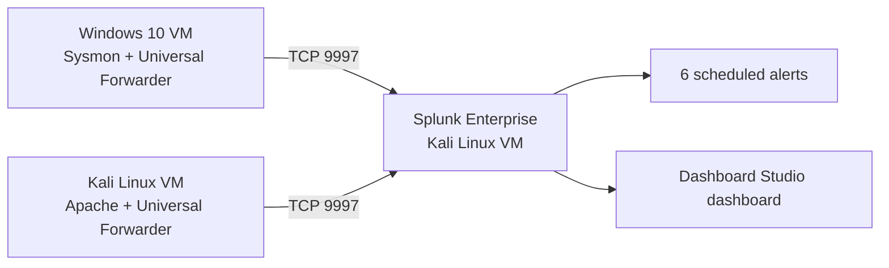
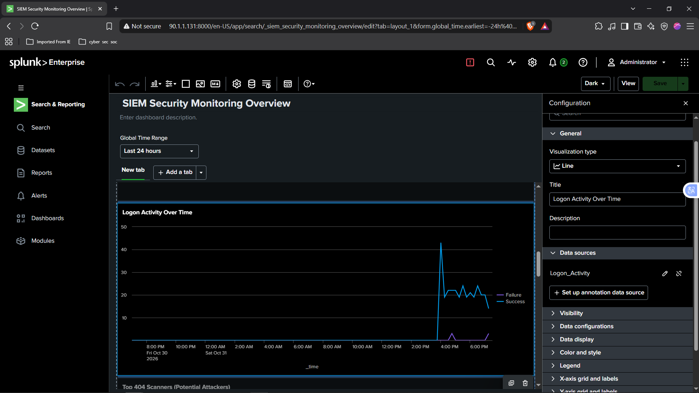
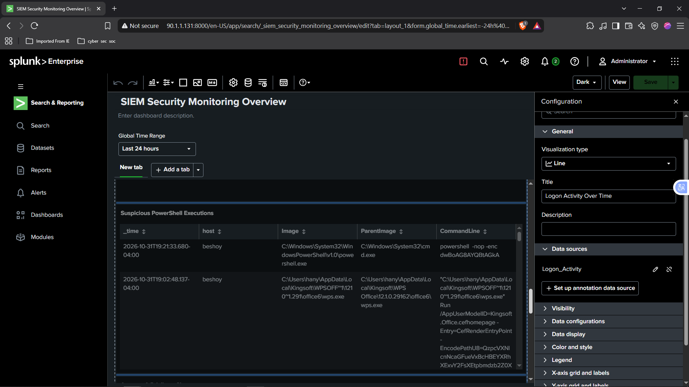
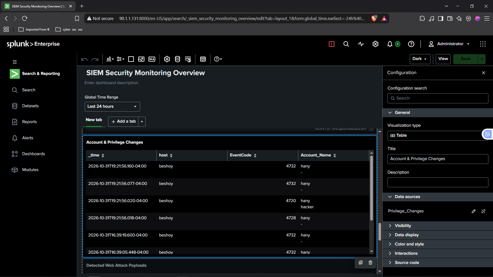
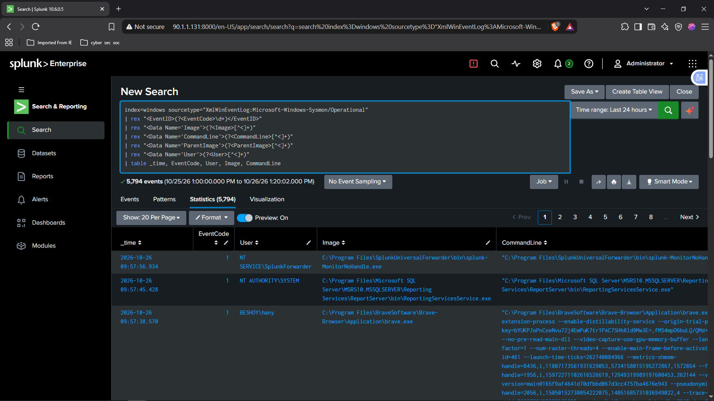

# Splunk SIEM Detection Lab

A home-lab SIEM built with **Splunk Enterprise** that collects Windows, Sysmon, Linux and Apache logs, detects suspicious activity with six MITRE ATT&CK-mapped alerts, and visualizes everything on a SOC-style dashboard. Every detection was validated by simulating the attack in the lab.

## Architecture



| Component | Role |
|---|---|
| Splunk Enterprise (Kali VM) | Indexer, search head, alerting, dashboards |
| Windows 10 VM | Security / System / Application logs and Sysmon, sent via Universal Forwarder to `index=windows` |
| Kali VM (forwarder) | Apache access/error logs and syslog, sent to `index=linux` |

## Phase 1: Log collection

Sources ingested and verified in Splunk:

- Windows Event Logs (Security, System, Application)
- Sysmon (`XmlWinEventLog:Microsoft-Windows-Sysmon/Operational`)
- Apache access logs (`access_combined`)
- Linux syslog

Issues I ran into and fixed:

- Apache logs first landed in `index=main`; moved them to `index=linux`.
- Event ID 4625 (failed logon) was missing, so I generated it with deliberate wrong-password attempts.
- Sysmon fields (`EventCode`, `Image`, `CommandLine`, `ParentImage`) were not auto-extracted from the XML, so the searches use `rex`.

See `configs/` for the forwarder configuration and `screenshots/phase1-log-collection/` for evidence.

## Phase 2: Detection rules

All rules are saved as Splunk alerts that run every 5 minutes (`*/5 * * * *`) over the last 15 minutes and trigger when results > 0. The SPL for each is in [`detections/`](detections/).

| # | Rule | MITRE ATT&CK | Data source | How it was tested |
|---|---|---|---|---|
| 1 | Multiple Failed Logins | T1110 | Windows Security 4625 | 3 wrong passwords at the lock screen |
| 2 | Brute Force Success | T1110 | Windows Security 4625 + 4624 | Failed logons followed by a successful one |
| 3 | Suspicious PowerShell | T1059.001 | Sysmon Event ID 1 | `powershell -nop -enc ...` |
| 4 | Privilege Escalation | T1136.001, T1098 | Windows Security 4720, 4728, 4732 | Created a test user and added it to local admins |
| 5 | Web Attack (SQLi / Traversal) | T1190 | Apache access log | curl with `../../etc/passwd` and SQLi payloads |
| 6 | Web Scanner Spike | T1595 | Apache access log | Repeated 404s from one client IP |

Tuning notes:

- Event ID 4672 was removed from the privilege rule because it fired constantly on background SYSTEM activity.
- Rule 2 can also fire after a normal typo followed by a correct login. A production version would require more failures or restrict to remote logon types.

See [`docs/attack-simulations.md`](docs/attack-simulations.md) for the simulations.

## Phase 3: Dashboard

The "SIEM Security Monitoring Overview" dashboard (Splunk Dashboard Studio) contains:

- Single values: alerts triggered, failed logons, 404 web scans
- Logon activity over time (successes vs failures)
- Tables: top 404 scanners, suspicious PowerShell executions, account and privilege changes, web attack payloads
- Log source health (events per sourcetype)

Import it in Dashboard Studio from `dashboard/`:

- `SIEM_Security_Monitoring_Overview.json`: original export
- `SIEM_Security_Monitoring_Overview_grid-layout.json`: same panels arranged in a compact grid

### Selected screenshots

| | |
|---|---|
|  |  |
|  |  |

## Limitations and next steps

- The "alerts triggered" counter sums alert firings. Because each alert runs every 5 minutes over a 15-minute window, one event can fire more than once. Throttling or matching the window to the schedule would fix this.
- All attacks are simulated in a lab, so detection thresholds are not tuned against real-world noise.
- Active Directory logs were out of scope for this version.
- Linux SSH brute-force detection (from `auth.log`) is not included yet.
- Ideas: email notifications, threat-intel lookups, automated response playbooks.

## Repository layout

```
configs/        forwarder configs (sanitized)
dashboard/      Dashboard Studio JSON exports
detections/     SPL for each alert
docs/           attack simulations
screenshots/    evidence by phase
```

## Tools

Splunk Enterprise, Splunk Universal Forwarder, Sysmon, Apache2, Kali Linux, VMware Workstation, MITRE ATT&CK.
